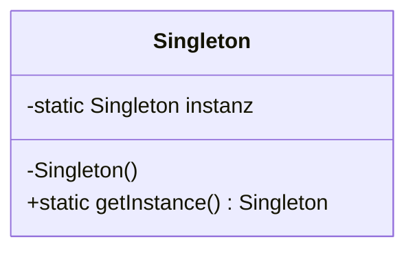
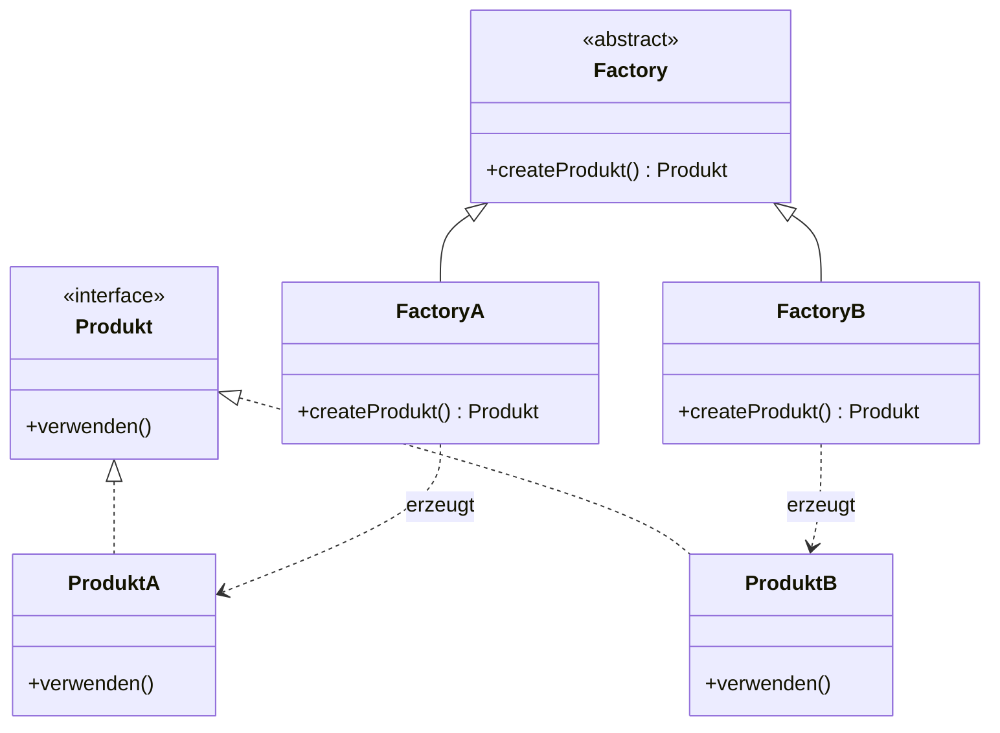
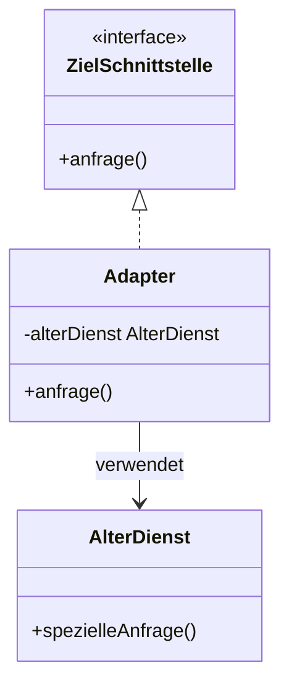
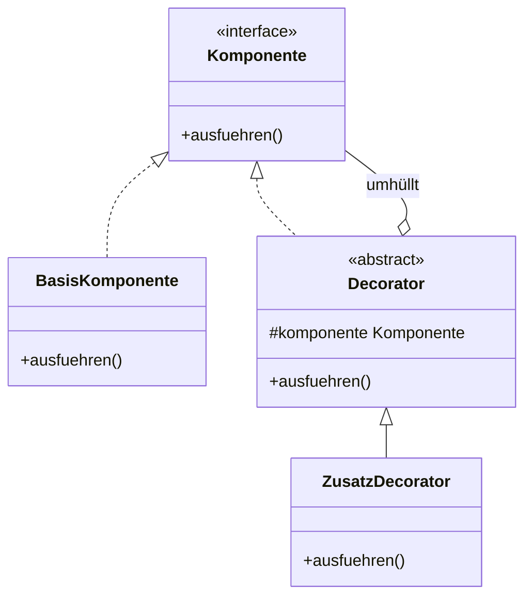
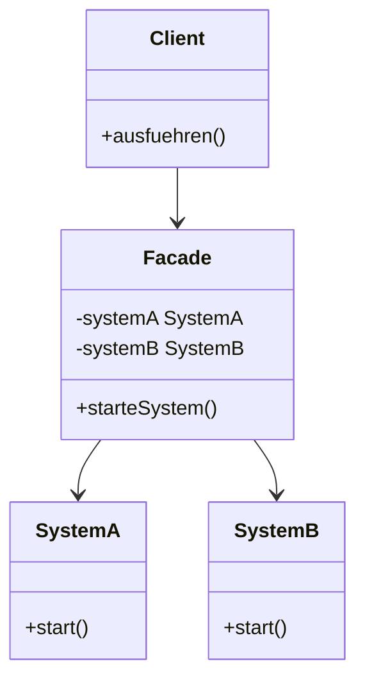
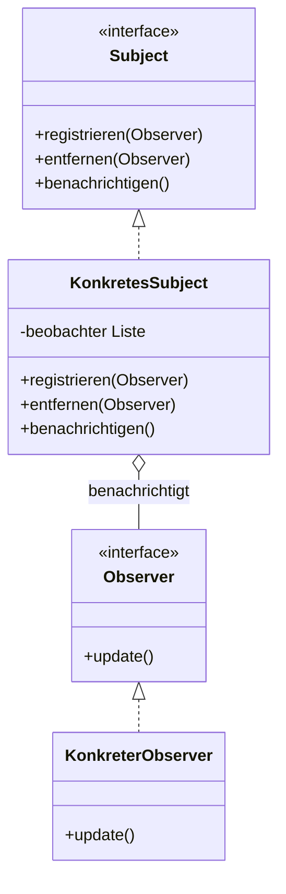
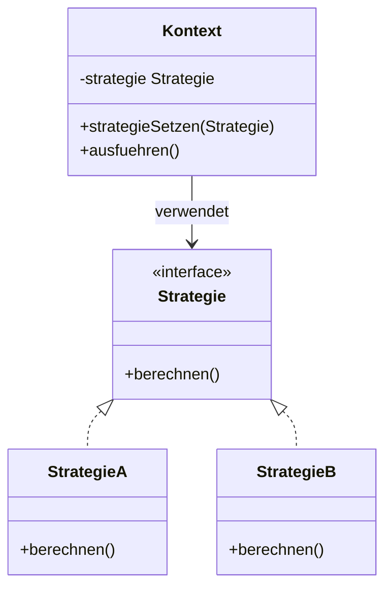
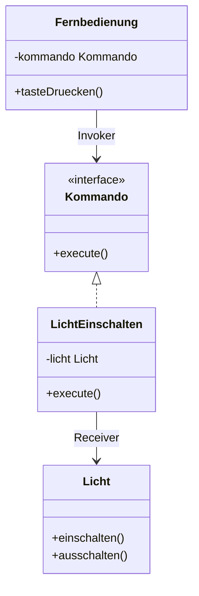
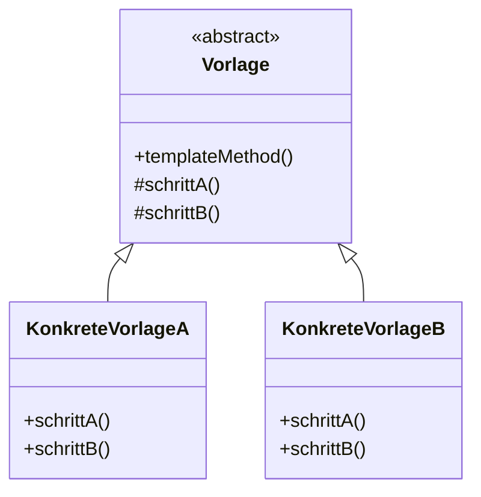

Ah, stimmt! 😊 Du musst nur diese 10 Design Patterns lernen. Hier sind sie jeweils als eigenes Mermaid-UML-Diagramm für Obsidian.

# 1. Singleton – Erzeugungsmuster



# 2. Factory Method – Erzeugungsmuster



# 3. Adapter – Strukturmuster



# 4. Decorator – Strukturmuster


# 5. Facade – Strukturmuster


# 6. Observer – Verhaltensmuster



# 7. Strategy – Verhaltensmuster



# 8. Command – Verhaltensmuster



# 9. Template Method – Verhaltensmuster



# 10. Iterator – Verhaltensmuster

```mermaid
classDiagram
    class Iterator {
        <<interface>>
        +hasNext() boolean
        +next() Element
    }

    class KonkreterIterator {
        -position
        -sammlung Sammlung
        +hasNext() boolean
        +next() Element
    }

    class Sammlung {
        <<interface>>
        +createIterator() Iterator
    }

    class KonkreteSammlung {
        -elemente Liste
        +createIterator() Iterator
    }

    Iterator <|.. KonkreterIterator
    Sammlung <|.. KonkreteSammlung
    KonkreteSammlung --> KonkreterIterator : erstellt
    KonkreterIterator --> KonkreteSammlung : durchläuft
    ``

## Übersicht zum Lernen

|Pattern|Kategorie|Wichtigste UML-Erkennung|
|---|---|---|
|Singleton|Erzeugung|Private Konstruktor, statische Instanz|
|Factory Method|Erzeugung|Factory erzeugt Produkte|
|Adapter|Struktur|Adapter verbindet Schnittstellen|
|Decorator|Struktur|Decorator enthält Komponente|
|Facade|Struktur|Facade greift auf Subsysteme zu|
|Observer|Verhalten|Subject benachrichtigt Observer|
|Strategy|Verhalten|Kontext verwendet Strategie|
|Command|Verhalten|Invoker → Command → Receiver|
|Template Method|Verhalten|Oberklasse und Unterklassen|
|Iterator|Verhalten|`hasNext()` und `next()`|

Tipp für die Prüfung: Achte besonders auf die Pfeile und Beziehungen. Oft erkennt man das richtige Pattern schon daran, welche Klasse ein Interface implementiert oder welche Klasse eine andere enthält.