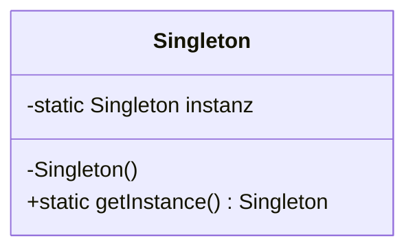
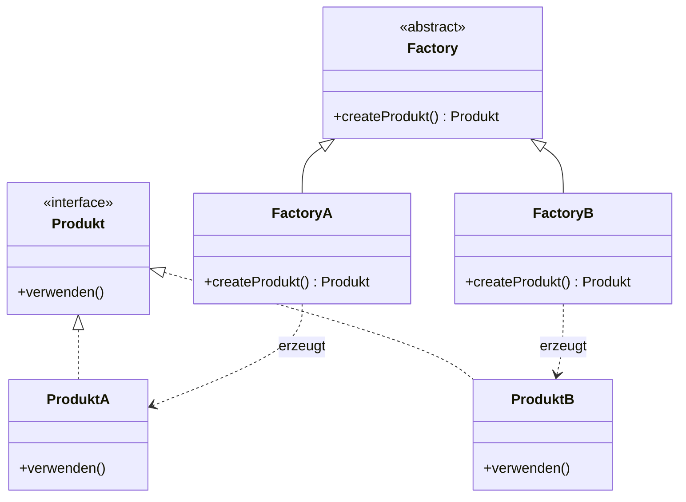
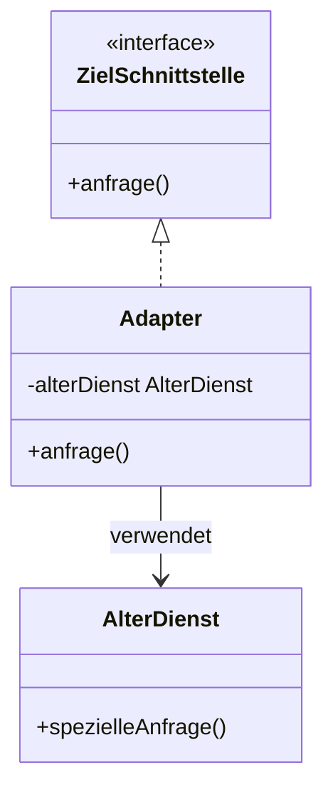
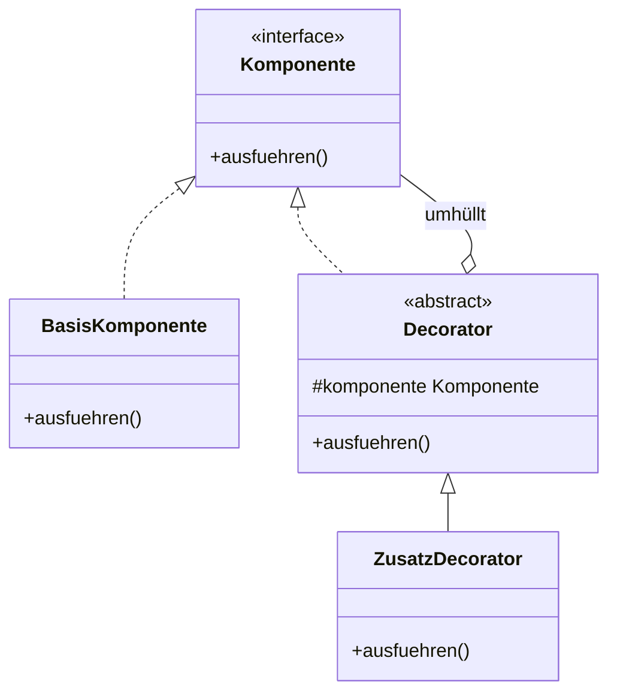
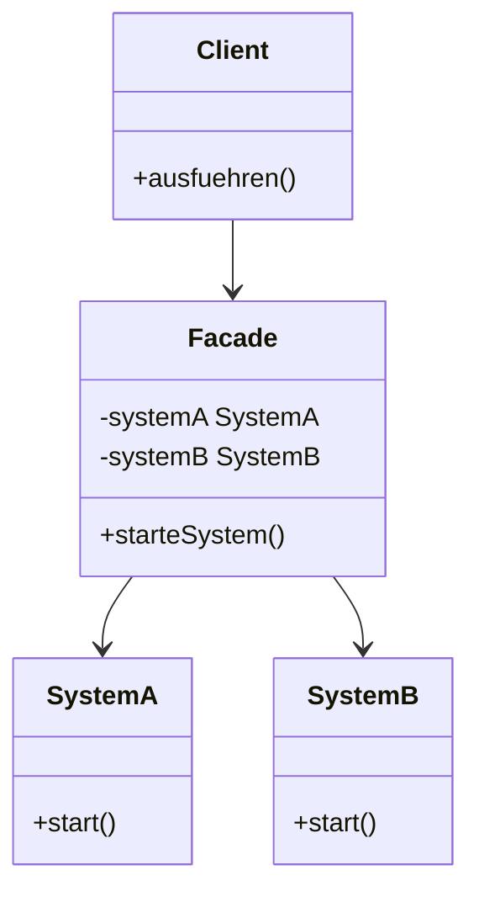
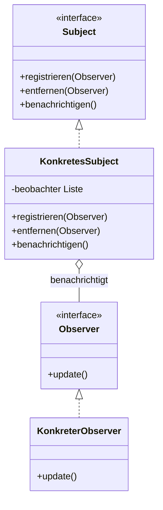

Ah, stimmt! 😊 Du musst nur diese 10 Design Patterns lernen. Hier sind sie jeweils als eigenes Mermaid-UML-Diagramm für Obsidian.

# 1. Singleton – Erzeugungsmuster

# 2. Factory Method – Erzeugungsmuster

# 3. Adapter – Strukturmuster

# 4. Decorator – Strukturmuster

# 5. Facade – Strukturmuster

# 6. Observer – Verhaltensmuster

# 7. Strategy – Verhaltensmuster

#chatgpt-mermaid-_r_g6_{font-family:-apple-system-body,ui-sans-serif,-apple-system,system-ui,"Segoe UI",Helvetica,"Apple Color Emoji",Arial,sans-serif,"Segoe UI Emoji","Segoe UI Symbol";font-size:16px;fill:rgb(237, 237, 237);}@keyframes edge-animation-frame{from{stroke-dashoffset:0;}}@keyframes dash{to{stroke-dashoffset:0;}}#chatgpt-mermaid-_r_g6_ .edge-animation-slow{stroke-dasharray:9,5!important;stroke-dashoffset:900;animation:dash 50s linear infinite;stroke-linecap:round;}#chatgpt-mermaid-_r_g6_ .edge-animation-fast{stroke-dasharray:9,5!important;stroke-dashoffset:900;animation:dash 20s linear infinite;stroke-linecap:round;}#chatgpt-mermaid-_r_g6_ .error-icon{fill:rgb(48, 48, 48);}#chatgpt-mermaid-_r_g6_ .error-text{fill:rgb(237, 237, 237);stroke:rgb(237, 237, 237);}#chatgpt-mermaid-_r_g6_ .edge-thickness-normal{stroke-width:1px;}#chatgpt-mermaid-_r_g6_ .edge-thickness-thick{stroke-width:3.5px;}#chatgpt-mermaid-_r_g6_ .edge-pattern-solid{stroke-dasharray:0;}#chatgpt-mermaid-_r_g6_ .edge-thickness-invisible{stroke-width:0;fill:none;}#chatgpt-mermaid-_r_g6_ .edge-pattern-dashed{stroke-dasharray:3;}#chatgpt-mermaid-_r_g6_ .edge-pattern-dotted{stroke-dasharray:2;}#chatgpt-mermaid-_r_g6_ .marker{fill:rgb(175, 175, 175);stroke:rgb(175, 175, 175);}#chatgpt-mermaid-_r_g6_ .marker.cross{stroke:rgb(175, 175, 175);}#chatgpt-mermaid-_r_g6_ svg{font-family:-apple-system-body,ui-sans-serif,-apple-system,system-ui,"Segoe UI",Helvetica,"Apple Color Emoji",Arial,sans-serif,"Segoe UI Emoji","Segoe UI Symbol";font-size:16px;}#chatgpt-mermaid-_r_g6_ p{margin:0;}#chatgpt-mermaid-_r_g6_ g.classGroup text{fill:rgb(31, 78, 148);stroke:none;font-family:-apple-system-body,ui-sans-serif,-apple-system,system-ui,"Segoe UI",Helvetica,"Apple Color Emoji",Arial,sans-serif,"Segoe UI Emoji","Segoe UI Symbol";font-size:10px;}#chatgpt-mermaid-_r_g6_ g.classGroup text .title{font-weight:bolder;}#chatgpt-mermaid-_r_g6_ .cluster-label text{fill:rgb(237, 237, 237);}#chatgpt-mermaid-_r_g6_ .cluster-label span{color:rgb(237, 237, 237);}#chatgpt-mermaid-_r_g6_ .cluster-label span p{background-color:transparent;}#chatgpt-mermaid-_r_g6_ .cluster rect{fill:rgb(48, 48, 48);stroke:rgba(255, 255, 255, 0.15);stroke-width:1px;}#chatgpt-mermaid-_r_g6_ .cluster text{fill:rgb(237, 237, 237);}#chatgpt-mermaid-_r_g6_ .cluster span{color:rgb(237, 237, 237);}#chatgpt-mermaid-_r_g6_ .nodeLabel,#chatgpt-mermaid-_r_g6_ .edgeLabel{color:rgb(237, 237, 237);}#chatgpt-mermaid-_r_g6_ .noteLabel .nodeLabel,#chatgpt-mermaid-_r_g6_ .noteLabel .edgeLabel{color:rgb(237, 237, 237);}#chatgpt-mermaid-_r_g6_ .edgeLabel .label rect{fill:rgb(9, 23, 44);}#chatgpt-mermaid-_r_g6_ .label text{fill:rgb(237, 237, 237);}#chatgpt-mermaid-_r_g6_ .labelBkg{background:rgb(9, 23, 44);}#chatgpt-mermaid-_r_g6_ .edgeLabel .label span{background:rgb(9, 23, 44);}#chatgpt-mermaid-_r_g6_ .classTitle{font-weight:bolder;}#chatgpt-mermaid-_r_g6_ .node rect,#chatgpt-mermaid-_r_g6_ .node circle,#chatgpt-mermaid-_r_g6_ .node ellipse,#chatgpt-mermaid-_r_g6_ .node polygon,#chatgpt-mermaid-_r_g6_ .node path{fill:rgb(9, 23, 44);stroke:rgb(31, 78, 148);stroke-width:1;}#chatgpt-mermaid-_r_g6_ .divider{stroke:rgb(31, 78, 148);stroke-width:1;}#chatgpt-mermaid-_r_g6_ g.clickable{cursor:pointer;}#chatgpt-mermaid-_r_g6_ g.classGroup rect{fill:rgb(9, 23, 44);stroke:rgb(31, 78, 148);}#chatgpt-mermaid-_r_g6_ g.classGroup line{stroke:rgb(31, 78, 148);stroke-width:1;}#chatgpt-mermaid-_r_g6_ .classLabel .box{stroke:none;stroke-width:0;fill:rgb(9, 23, 44);opacity:0.5;}#chatgpt-mermaid-_r_g6_ .classLabel .label{fill:rgb(31, 78, 148);font-size:10px;}#chatgpt-mermaid-_r_g6_ .relation{stroke:rgb(175, 175, 175);stroke-width:1;fill:none;}#chatgpt-mermaid-_r_g6_ .dashed-line{stroke-dasharray:3;}#chatgpt-mermaid-_r_g6_ .dotted-line{stroke-dasharray:1 2;}#chatgpt-mermaid-_r_g6_ [id$="-compositionStart"],#chatgpt-mermaid-_r_g6_ .composition{fill:rgb(175, 175, 175)!important;stroke:rgb(175, 175, 175)!important;stroke-width:1;}#chatgpt-mermaid-_r_g6_ [id$="-compositionEnd"],#chatgpt-mermaid-_r_g6_ .composition{fill:rgb(175, 175, 175)!important;stroke:rgb(175, 175, 175)!important;stroke-width:1;}#chatgpt-mermaid-_r_g6_ [id$="-dependencyStart"],#chatgpt-mermaid-_r_g6_ .dependency{fill:rgb(175, 175, 175)!important;stroke:rgb(175, 175, 175)!important;stroke-width:1;}#chatgpt-mermaid-_r_g6_ [id$="-dependencyEnd"],#chatgpt-mermaid-_r_g6_ .dependency{fill:rgb(175, 175, 175)!important;stroke:rgb(175, 175, 175)!important;stroke-width:1;}#chatgpt-mermaid-_r_g6_ [id$="-extensionStart"],#chatgpt-mermaid-_r_g6_ .extension{fill:transparent!important;stroke:rgb(175, 175, 175)!important;stroke-width:1;}#chatgpt-mermaid-_r_g6_ [id$="-extensionEnd"],#chatgpt-mermaid-_r_g6_ .extension{fill:transparent!important;stroke:rgb(175, 175, 175)!important;stroke-width:1;}#chatgpt-mermaid-_r_g6_ [id$="-aggregationStart"],#chatgpt-mermaid-_r_g6_ .aggregation{fill:transparent!important;stroke:rgb(175, 175, 175)!important;stroke-width:1;}#chatgpt-mermaid-_r_g6_ [id$="-aggregationEnd"],#chatgpt-mermaid-_r_g6_ .aggregation{fill:transparent!important;stroke:rgb(175, 175, 175)!important;stroke-width:1;}#chatgpt-mermaid-_r_g6_ [id$="-lollipopStart"],#chatgpt-mermaid-_r_g6_ .lollipop{fill:rgb(9, 23, 44)!important;stroke:rgb(175, 175, 175)!important;stroke-width:1;}#chatgpt-mermaid-_r_g6_ [id$="-lollipopEnd"],#chatgpt-mermaid-_r_g6_ .lollipop{fill:rgb(9, 23, 44)!important;stroke:rgb(175, 175, 175)!important;stroke-width:1;}#chatgpt-mermaid-_r_g6_ .edgeTerminals{font-size:11px;line-height:initial;}#chatgpt-mermaid-_r_g6_ .classTitleText{text-anchor:middle;font-size:18px;fill:rgb(237, 237, 237);}#chatgpt-mermaid-_r_g6_ .edgeLabel[data-look="neo"]{background-color:rgb(0, 0, 0);text-align:center;}#chatgpt-mermaid-_r_g6_ .edgeLabel[data-look="neo"] p{background-color:rgb(0, 0, 0);}#chatgpt-mermaid-_r_g6_ .edgeLabel[data-look="neo"] rect{opacity:0.5;background-color:rgb(0, 0, 0);fill:rgb(0, 0, 0);}#chatgpt-mermaid-_r_g6_ .label-icon{display:inline-block;height:1em;overflow:visible;vertical-align:-0.125em;}#chatgpt-mermaid-_r_g6_ .node .label-icon path{fill:currentColor;stroke:revert;stroke-width:revert;}#chatgpt-mermaid-_r_g6_ .node .neo-node{stroke:rgb(31, 78, 148);}#chatgpt-mermaid-_r_g6_ [data-look="neo"].node rect,#chatgpt-mermaid-_r_g6_ [data-look="neo"].cluster rect,#chatgpt-mermaid-_r_g6_ [data-look="neo"].node polygon{stroke:url(#chatgpt-mermaid-_r_g6_-gradient);filter:drop-shadow( 1px 2px 2px rgba(185,185,185,1));}#chatgpt-mermaid-_r_g6_ [data-look="neo"].swimlane.cluster rect{filter:none;}#chatgpt-mermaid-_r_g6_ [data-look="neo"].node path{stroke:url(#chatgpt-mermaid-_r_g6_-gradient);stroke-width:1px;}#chatgpt-mermaid-_r_g6_ [data-look="neo"].node .outer-path{filter:drop-shadow( 1px 2px 2px rgba(185,185,185,1));}#chatgpt-mermaid-_r_g6_ [data-look="neo"].node .neo-line path{stroke:rgb(31, 78, 148);filter:none;}#chatgpt-mermaid-_r_g6_ [data-look="neo"].node circle{stroke:url(#chatgpt-mermaid-_r_g6_-gradient);filter:drop-shadow( 1px 2px 2px rgba(185,185,185,1));}#chatgpt-mermaid-_r_g6_ [data-look="neo"].node circle .state-start{fill:#000000;}#chatgpt-mermaid-_r_g6_ [data-look="neo"].icon-shape .icon{fill:url(#chatgpt-mermaid-_r_g6_-gradient);filter:drop-shadow( 1px 2px 2px rgba(185,185,185,1));}#chatgpt-mermaid-_r_g6_ [data-look="neo"].icon-shape .icon-neo path{stroke:url(#chatgpt-mermaid-_r_g6_-gradient);filter:drop-shadow( 1px 2px 2px rgba(185,185,185,1));}#chatgpt-mermaid-_r_g6_ :root{--mermaid-font-family:-apple-system-body,ui-sans-serif,-apple-system,system-ui,"Segoe UI",Helvetica,"Apple Color Emoji",Arial,sans-serif,"Segoe UI Emoji","Segoe UI Symbol";}«interface»Strategie+berechnen()StrategieA+berechnen()StrategieB+berechnen()Kontext-strategie Strategie+strategieSetzen(Strategie)+ausfuehren()verwendet

# 8. Command – Verhaltensmuster

#chatgpt-mermaid-_r_gd_{font-family:-apple-system-body,ui-sans-serif,-apple-system,system-ui,"Segoe UI",Helvetica,"Apple Color Emoji",Arial,sans-serif,"Segoe UI Emoji","Segoe UI Symbol";font-size:16px;fill:rgb(237, 237, 237);}@keyframes edge-animation-frame{from{stroke-dashoffset:0;}}@keyframes dash{to{stroke-dashoffset:0;}}#chatgpt-mermaid-_r_gd_ .edge-animation-slow{stroke-dasharray:9,5!important;stroke-dashoffset:900;animation:dash 50s linear infinite;stroke-linecap:round;}#chatgpt-mermaid-_r_gd_ .edge-animation-fast{stroke-dasharray:9,5!important;stroke-dashoffset:900;animation:dash 20s linear infinite;stroke-linecap:round;}#chatgpt-mermaid-_r_gd_ .error-icon{fill:rgb(48, 48, 48);}#chatgpt-mermaid-_r_gd_ .error-text{fill:rgb(237, 237, 237);stroke:rgb(237, 237, 237);}#chatgpt-mermaid-_r_gd_ .edge-thickness-normal{stroke-width:1px;}#chatgpt-mermaid-_r_gd_ .edge-thickness-thick{stroke-width:3.5px;}#chatgpt-mermaid-_r_gd_ .edge-pattern-solid{stroke-dasharray:0;}#chatgpt-mermaid-_r_gd_ .edge-thickness-invisible{stroke-width:0;fill:none;}#chatgpt-mermaid-_r_gd_ .edge-pattern-dashed{stroke-dasharray:3;}#chatgpt-mermaid-_r_gd_ .edge-pattern-dotted{stroke-dasharray:2;}#chatgpt-mermaid-_r_gd_ .marker{fill:rgb(175, 175, 175);stroke:rgb(175, 175, 175);}#chatgpt-mermaid-_r_gd_ .marker.cross{stroke:rgb(175, 175, 175);}#chatgpt-mermaid-_r_gd_ svg{font-family:-apple-system-body,ui-sans-serif,-apple-system,system-ui,"Segoe UI",Helvetica,"Apple Color Emoji",Arial,sans-serif,"Segoe UI Emoji","Segoe UI Symbol";font-size:16px;}#chatgpt-mermaid-_r_gd_ p{margin:0;}#chatgpt-mermaid-_r_gd_ g.classGroup text{fill:rgb(31, 78, 148);stroke:none;font-family:-apple-system-body,ui-sans-serif,-apple-system,system-ui,"Segoe UI",Helvetica,"Apple Color Emoji",Arial,sans-serif,"Segoe UI Emoji","Segoe UI Symbol";font-size:10px;}#chatgpt-mermaid-_r_gd_ g.classGroup text .title{font-weight:bolder;}#chatgpt-mermaid-_r_gd_ .cluster-label text{fill:rgb(237, 237, 237);}#chatgpt-mermaid-_r_gd_ .cluster-label span{color:rgb(237, 237, 237);}#chatgpt-mermaid-_r_gd_ .cluster-label span p{background-color:transparent;}#chatgpt-mermaid-_r_gd_ .cluster rect{fill:rgb(48, 48, 48);stroke:rgba(255, 255, 255, 0.15);stroke-width:1px;}#chatgpt-mermaid-_r_gd_ .cluster text{fill:rgb(237, 237, 237);}#chatgpt-mermaid-_r_gd_ .cluster span{color:rgb(237, 237, 237);}#chatgpt-mermaid-_r_gd_ .nodeLabel,#chatgpt-mermaid-_r_gd_ .edgeLabel{color:rgb(237, 237, 237);}#chatgpt-mermaid-_r_gd_ .noteLabel .nodeLabel,#chatgpt-mermaid-_r_gd_ .noteLabel .edgeLabel{color:rgb(237, 237, 237);}#chatgpt-mermaid-_r_gd_ .edgeLabel .label rect{fill:rgb(9, 23, 44);}#chatgpt-mermaid-_r_gd_ .label text{fill:rgb(237, 237, 237);}#chatgpt-mermaid-_r_gd_ .labelBkg{background:rgb(9, 23, 44);}#chatgpt-mermaid-_r_gd_ .edgeLabel .label span{background:rgb(9, 23, 44);}#chatgpt-mermaid-_r_gd_ .classTitle{font-weight:bolder;}#chatgpt-mermaid-_r_gd_ .node rect,#chatgpt-mermaid-_r_gd_ .node circle,#chatgpt-mermaid-_r_gd_ .node ellipse,#chatgpt-mermaid-_r_gd_ .node polygon,#chatgpt-mermaid-_r_gd_ .node path{fill:rgb(9, 23, 44);stroke:rgb(31, 78, 148);stroke-width:1;}#chatgpt-mermaid-_r_gd_ .divider{stroke:rgb(31, 78, 148);stroke-width:1;}#chatgpt-mermaid-_r_gd_ g.clickable{cursor:pointer;}#chatgpt-mermaid-_r_gd_ g.classGroup rect{fill:rgb(9, 23, 44);stroke:rgb(31, 78, 148);}#chatgpt-mermaid-_r_gd_ g.classGroup line{stroke:rgb(31, 78, 148);stroke-width:1;}#chatgpt-mermaid-_r_gd_ .classLabel .box{stroke:none;stroke-width:0;fill:rgb(9, 23, 44);opacity:0.5;}#chatgpt-mermaid-_r_gd_ .classLabel .label{fill:rgb(31, 78, 148);font-size:10px;}#chatgpt-mermaid-_r_gd_ .relation{stroke:rgb(175, 175, 175);stroke-width:1;fill:none;}#chatgpt-mermaid-_r_gd_ .dashed-line{stroke-dasharray:3;}#chatgpt-mermaid-_r_gd_ .dotted-line{stroke-dasharray:1 2;}#chatgpt-mermaid-_r_gd_ [id$="-compositionStart"],#chatgpt-mermaid-_r_gd_ .composition{fill:rgb(175, 175, 175)!important;stroke:rgb(175, 175, 175)!important;stroke-width:1;}#chatgpt-mermaid-_r_gd_ [id$="-compositionEnd"],#chatgpt-mermaid-_r_gd_ .composition{fill:rgb(175, 175, 175)!important;stroke:rgb(175, 175, 175)!important;stroke-width:1;}#chatgpt-mermaid-_r_gd_ [id$="-dependencyStart"],#chatgpt-mermaid-_r_gd_ .dependency{fill:rgb(175, 175, 175)!important;stroke:rgb(175, 175, 175)!important;stroke-width:1;}#chatgpt-mermaid-_r_gd_ [id$="-dependencyEnd"],#chatgpt-mermaid-_r_gd_ .dependency{fill:rgb(175, 175, 175)!important;stroke:rgb(175, 175, 175)!important;stroke-width:1;}#chatgpt-mermaid-_r_gd_ [id$="-extensionStart"],#chatgpt-mermaid-_r_gd_ .extension{fill:transparent!important;stroke:rgb(175, 175, 175)!important;stroke-width:1;}#chatgpt-mermaid-_r_gd_ [id$="-extensionEnd"],#chatgpt-mermaid-_r_gd_ .extension{fill:transparent!important;stroke:rgb(175, 175, 175)!important;stroke-width:1;}#chatgpt-mermaid-_r_gd_ [id$="-aggregationStart"],#chatgpt-mermaid-_r_gd_ .aggregation{fill:transparent!important;stroke:rgb(175, 175, 175)!important;stroke-width:1;}#chatgpt-mermaid-_r_gd_ [id$="-aggregationEnd"],#chatgpt-mermaid-_r_gd_ .aggregation{fill:transparent!important;stroke:rgb(175, 175, 175)!important;stroke-width:1;}#chatgpt-mermaid-_r_gd_ [id$="-lollipopStart"],#chatgpt-mermaid-_r_gd_ .lollipop{fill:rgb(9, 23, 44)!important;stroke:rgb(175, 175, 175)!important;stroke-width:1;}#chatgpt-mermaid-_r_gd_ [id$="-lollipopEnd"],#chatgpt-mermaid-_r_gd_ .lollipop{fill:rgb(9, 23, 44)!important;stroke:rgb(175, 175, 175)!important;stroke-width:1;}#chatgpt-mermaid-_r_gd_ .edgeTerminals{font-size:11px;line-height:initial;}#chatgpt-mermaid-_r_gd_ .classTitleText{text-anchor:middle;font-size:18px;fill:rgb(237, 237, 237);}#chatgpt-mermaid-_r_gd_ .edgeLabel[data-look="neo"]{background-color:rgb(0, 0, 0);text-align:center;}#chatgpt-mermaid-_r_gd_ .edgeLabel[data-look="neo"] p{background-color:rgb(0, 0, 0);}#chatgpt-mermaid-_r_gd_ .edgeLabel[data-look="neo"] rect{opacity:0.5;background-color:rgb(0, 0, 0);fill:rgb(0, 0, 0);}#chatgpt-mermaid-_r_gd_ .label-icon{display:inline-block;height:1em;overflow:visible;vertical-align:-0.125em;}#chatgpt-mermaid-_r_gd_ .node .label-icon path{fill:currentColor;stroke:revert;stroke-width:revert;}#chatgpt-mermaid-_r_gd_ .node .neo-node{stroke:rgb(31, 78, 148);}#chatgpt-mermaid-_r_gd_ [data-look="neo"].node rect,#chatgpt-mermaid-_r_gd_ [data-look="neo"].cluster rect,#chatgpt-mermaid-_r_gd_ [data-look="neo"].node polygon{stroke:url(#chatgpt-mermaid-_r_gd_-gradient);filter:drop-shadow( 1px 2px 2px rgba(185,185,185,1));}#chatgpt-mermaid-_r_gd_ [data-look="neo"].swimlane.cluster rect{filter:none;}#chatgpt-mermaid-_r_gd_ [data-look="neo"].node path{stroke:url(#chatgpt-mermaid-_r_gd_-gradient);stroke-width:1px;}#chatgpt-mermaid-_r_gd_ [data-look="neo"].node .outer-path{filter:drop-shadow( 1px 2px 2px rgba(185,185,185,1));}#chatgpt-mermaid-_r_gd_ [data-look="neo"].node .neo-line path{stroke:rgb(31, 78, 148);filter:none;}#chatgpt-mermaid-_r_gd_ [data-look="neo"].node circle{stroke:url(#chatgpt-mermaid-_r_gd_-gradient);filter:drop-shadow( 1px 2px 2px rgba(185,185,185,1));}#chatgpt-mermaid-_r_gd_ [data-look="neo"].node circle .state-start{fill:#000000;}#chatgpt-mermaid-_r_gd_ [data-look="neo"].icon-shape .icon{fill:url(#chatgpt-mermaid-_r_gd_-gradient);filter:drop-shadow( 1px 2px 2px rgba(185,185,185,1));}#chatgpt-mermaid-_r_gd_ [data-look="neo"].icon-shape .icon-neo path{stroke:url(#chatgpt-mermaid-_r_gd_-gradient);filter:drop-shadow( 1px 2px 2px rgba(185,185,185,1));}#chatgpt-mermaid-_r_gd_ :root{--mermaid-font-family:-apple-system-body,ui-sans-serif,-apple-system,system-ui,"Segoe UI",Helvetica,"Apple Color Emoji",Arial,sans-serif,"Segoe UI Emoji","Segoe UI Symbol";}«interface»Kommando+execute()LichtEinschalten-licht Licht+execute()Licht+einschalten()+ausschalten()Fernbedienung-kommando Kommando+tasteDruecken()ReceiverInvoker

# 9. Template Method – Verhaltensmuster

#chatgpt-mermaid-_r_gk_{font-family:-apple-system-body,ui-sans-serif,-apple-system,system-ui,"Segoe UI",Helvetica,"Apple Color Emoji",Arial,sans-serif,"Segoe UI Emoji","Segoe UI Symbol";font-size:16px;fill:rgb(237, 237, 237);}@keyframes edge-animation-frame{from{stroke-dashoffset:0;}}@keyframes dash{to{stroke-dashoffset:0;}}#chatgpt-mermaid-_r_gk_ .edge-animation-slow{stroke-dasharray:9,5!important;stroke-dashoffset:900;animation:dash 50s linear infinite;stroke-linecap:round;}#chatgpt-mermaid-_r_gk_ .edge-animation-fast{stroke-dasharray:9,5!important;stroke-dashoffset:900;animation:dash 20s linear infinite;stroke-linecap:round;}#chatgpt-mermaid-_r_gk_ .error-icon{fill:rgb(48, 48, 48);}#chatgpt-mermaid-_r_gk_ .error-text{fill:rgb(237, 237, 237);stroke:rgb(237, 237, 237);}#chatgpt-mermaid-_r_gk_ .edge-thickness-normal{stroke-width:1px;}#chatgpt-mermaid-_r_gk_ .edge-thickness-thick{stroke-width:3.5px;}#chatgpt-mermaid-_r_gk_ .edge-pattern-solid{stroke-dasharray:0;}#chatgpt-mermaid-_r_gk_ .edge-thickness-invisible{stroke-width:0;fill:none;}#chatgpt-mermaid-_r_gk_ .edge-pattern-dashed{stroke-dasharray:3;}#chatgpt-mermaid-_r_gk_ .edge-pattern-dotted{stroke-dasharray:2;}#chatgpt-mermaid-_r_gk_ .marker{fill:rgb(175, 175, 175);stroke:rgb(175, 175, 175);}#chatgpt-mermaid-_r_gk_ .marker.cross{stroke:rgb(175, 175, 175);}#chatgpt-mermaid-_r_gk_ svg{font-family:-apple-system-body,ui-sans-serif,-apple-system,system-ui,"Segoe UI",Helvetica,"Apple Color Emoji",Arial,sans-serif,"Segoe UI Emoji","Segoe UI Symbol";font-size:16px;}#chatgpt-mermaid-_r_gk_ p{margin:0;}#chatgpt-mermaid-_r_gk_ g.classGroup text{fill:rgb(31, 78, 148);stroke:none;font-family:-apple-system-body,ui-sans-serif,-apple-system,system-ui,"Segoe UI",Helvetica,"Apple Color Emoji",Arial,sans-serif,"Segoe UI Emoji","Segoe UI Symbol";font-size:10px;}#chatgpt-mermaid-_r_gk_ g.classGroup text .title{font-weight:bolder;}#chatgpt-mermaid-_r_gk_ .cluster-label text{fill:rgb(237, 237, 237);}#chatgpt-mermaid-_r_gk_ .cluster-label span{color:rgb(237, 237, 237);}#chatgpt-mermaid-_r_gk_ .cluster-label span p{background-color:transparent;}#chatgpt-mermaid-_r_gk_ .cluster rect{fill:rgb(48, 48, 48);stroke:rgba(255, 255, 255, 0.15);stroke-width:1px;}#chatgpt-mermaid-_r_gk_ .cluster text{fill:rgb(237, 237, 237);}#chatgpt-mermaid-_r_gk_ .cluster span{color:rgb(237, 237, 237);}#chatgpt-mermaid-_r_gk_ .nodeLabel,#chatgpt-mermaid-_r_gk_ .edgeLabel{color:rgb(237, 237, 237);}#chatgpt-mermaid-_r_gk_ .noteLabel .nodeLabel,#chatgpt-mermaid-_r_gk_ .noteLabel .edgeLabel{color:rgb(237, 237, 237);}#chatgpt-mermaid-_r_gk_ .edgeLabel .label rect{fill:rgb(9, 23, 44);}#chatgpt-mermaid-_r_gk_ .label text{fill:rgb(237, 237, 237);}#chatgpt-mermaid-_r_gk_ .labelBkg{background:rgb(9, 23, 44);}#chatgpt-mermaid-_r_gk_ .edgeLabel .label span{background:rgb(9, 23, 44);}#chatgpt-mermaid-_r_gk_ .classTitle{font-weight:bolder;}#chatgpt-mermaid-_r_gk_ .node rect,#chatgpt-mermaid-_r_gk_ .node circle,#chatgpt-mermaid-_r_gk_ .node ellipse,#chatgpt-mermaid-_r_gk_ .node polygon,#chatgpt-mermaid-_r_gk_ .node path{fill:rgb(9, 23, 44);stroke:rgb(31, 78, 148);stroke-width:1;}#chatgpt-mermaid-_r_gk_ .divider{stroke:rgb(31, 78, 148);stroke-width:1;}#chatgpt-mermaid-_r_gk_ g.clickable{cursor:pointer;}#chatgpt-mermaid-_r_gk_ g.classGroup rect{fill:rgb(9, 23, 44);stroke:rgb(31, 78, 148);}#chatgpt-mermaid-_r_gk_ g.classGroup line{stroke:rgb(31, 78, 148);stroke-width:1;}#chatgpt-mermaid-_r_gk_ .classLabel .box{stroke:none;stroke-width:0;fill:rgb(9, 23, 44);opacity:0.5;}#chatgpt-mermaid-_r_gk_ .classLabel .label{fill:rgb(31, 78, 148);font-size:10px;}#chatgpt-mermaid-_r_gk_ .relation{stroke:rgb(175, 175, 175);stroke-width:1;fill:none;}#chatgpt-mermaid-_r_gk_ .dashed-line{stroke-dasharray:3;}#chatgpt-mermaid-_r_gk_ .dotted-line{stroke-dasharray:1 2;}#chatgpt-mermaid-_r_gk_ [id$="-compositionStart"],#chatgpt-mermaid-_r_gk_ .composition{fill:rgb(175, 175, 175)!important;stroke:rgb(175, 175, 175)!important;stroke-width:1;}#chatgpt-mermaid-_r_gk_ [id$="-compositionEnd"],#chatgpt-mermaid-_r_gk_ .composition{fill:rgb(175, 175, 175)!important;stroke:rgb(175, 175, 175)!important;stroke-width:1;}#chatgpt-mermaid-_r_gk_ [id$="-dependencyStart"],#chatgpt-mermaid-_r_gk_ .dependency{fill:rgb(175, 175, 175)!important;stroke:rgb(175, 175, 175)!important;stroke-width:1;}#chatgpt-mermaid-_r_gk_ [id$="-dependencyEnd"],#chatgpt-mermaid-_r_gk_ .dependency{fill:rgb(175, 175, 175)!important;stroke:rgb(175, 175, 175)!important;stroke-width:1;}#chatgpt-mermaid-_r_gk_ [id$="-extensionStart"],#chatgpt-mermaid-_r_gk_ .extension{fill:transparent!important;stroke:rgb(175, 175, 175)!important;stroke-width:1;}#chatgpt-mermaid-_r_gk_ [id$="-extensionEnd"],#chatgpt-mermaid-_r_gk_ .extension{fill:transparent!important;stroke:rgb(175, 175, 175)!important;stroke-width:1;}#chatgpt-mermaid-_r_gk_ [id$="-aggregationStart"],#chatgpt-mermaid-_r_gk_ .aggregation{fill:transparent!important;stroke:rgb(175, 175, 175)!important;stroke-width:1;}#chatgpt-mermaid-_r_gk_ [id$="-aggregationEnd"],#chatgpt-mermaid-_r_gk_ .aggregation{fill:transparent!important;stroke:rgb(175, 175, 175)!important;stroke-width:1;}#chatgpt-mermaid-_r_gk_ [id$="-lollipopStart"],#chatgpt-mermaid-_r_gk_ .lollipop{fill:rgb(9, 23, 44)!important;stroke:rgb(175, 175, 175)!important;stroke-width:1;}#chatgpt-mermaid-_r_gk_ [id$="-lollipopEnd"],#chatgpt-mermaid-_r_gk_ .lollipop{fill:rgb(9, 23, 44)!important;stroke:rgb(175, 175, 175)!important;stroke-width:1;}#chatgpt-mermaid-_r_gk_ .edgeTerminals{font-size:11px;line-height:initial;}#chatgpt-mermaid-_r_gk_ .classTitleText{text-anchor:middle;font-size:18px;fill:rgb(237, 237, 237);}#chatgpt-mermaid-_r_gk_ .edgeLabel[data-look="neo"]{background-color:rgb(0, 0, 0);text-align:center;}#chatgpt-mermaid-_r_gk_ .edgeLabel[data-look="neo"] p{background-color:rgb(0, 0, 0);}#chatgpt-mermaid-_r_gk_ .edgeLabel[data-look="neo"] rect{opacity:0.5;background-color:rgb(0, 0, 0);fill:rgb(0, 0, 0);}#chatgpt-mermaid-_r_gk_ .label-icon{display:inline-block;height:1em;overflow:visible;vertical-align:-0.125em;}#chatgpt-mermaid-_r_gk_ .node .label-icon path{fill:currentColor;stroke:revert;stroke-width:revert;}#chatgpt-mermaid-_r_gk_ .node .neo-node{stroke:rgb(31, 78, 148);}#chatgpt-mermaid-_r_gk_ [data-look="neo"].node rect,#chatgpt-mermaid-_r_gk_ [data-look="neo"].cluster rect,#chatgpt-mermaid-_r_gk_ [data-look="neo"].node polygon{stroke:url(#chatgpt-mermaid-_r_gk_-gradient);filter:drop-shadow( 1px 2px 2px rgba(185,185,185,1));}#chatgpt-mermaid-_r_gk_ [data-look="neo"].swimlane.cluster rect{filter:none;}#chatgpt-mermaid-_r_gk_ [data-look="neo"].node path{stroke:url(#chatgpt-mermaid-_r_gk_-gradient);stroke-width:1px;}#chatgpt-mermaid-_r_gk_ [data-look="neo"].node .outer-path{filter:drop-shadow( 1px 2px 2px rgba(185,185,185,1));}#chatgpt-mermaid-_r_gk_ [data-look="neo"].node .neo-line path{stroke:rgb(31, 78, 148);filter:none;}#chatgpt-mermaid-_r_gk_ [data-look="neo"].node circle{stroke:url(#chatgpt-mermaid-_r_gk_-gradient);filter:drop-shadow( 1px 2px 2px rgba(185,185,185,1));}#chatgpt-mermaid-_r_gk_ [data-look="neo"].node circle .state-start{fill:#000000;}#chatgpt-mermaid-_r_gk_ [data-look="neo"].icon-shape .icon{fill:url(#chatgpt-mermaid-_r_gk_-gradient);filter:drop-shadow( 1px 2px 2px rgba(185,185,185,1));}#chatgpt-mermaid-_r_gk_ [data-look="neo"].icon-shape .icon-neo path{stroke:url(#chatgpt-mermaid-_r_gk_-gradient);filter:drop-shadow( 1px 2px 2px rgba(185,185,185,1));}#chatgpt-mermaid-_r_gk_ :root{--mermaid-font-family:-apple-system-body,ui-sans-serif,-apple-system,system-ui,"Segoe UI",Helvetica,"Apple Color Emoji",Arial,sans-serif,"Segoe UI Emoji","Segoe UI Symbol";}«abstract»Vorlage+templateMethod()#schrittA()#schrittB()KonkreteVorlageA+schrittA()+schrittB()KonkreteVorlageB+schrittA()+schrittB()

# 10. Iterator – Verhaltensmuster

#chatgpt-mermaid-_r_gr_{font-family:-apple-system-body,ui-sans-serif,-apple-system,system-ui,"Segoe UI",Helvetica,"Apple Color Emoji",Arial,sans-serif,"Segoe UI Emoji","Segoe UI Symbol";font-size:16px;fill:rgb(237, 237, 237);}@keyframes edge-animation-frame{from{stroke-dashoffset:0;}}@keyframes dash{to{stroke-dashoffset:0;}}#chatgpt-mermaid-_r_gr_ .edge-animation-slow{stroke-dasharray:9,5!important;stroke-dashoffset:900;animation:dash 50s linear infinite;stroke-linecap:round;}#chatgpt-mermaid-_r_gr_ .edge-animation-fast{stroke-dasharray:9,5!important;stroke-dashoffset:900;animation:dash 20s linear infinite;stroke-linecap:round;}#chatgpt-mermaid-_r_gr_ .error-icon{fill:rgb(48, 48, 48);}#chatgpt-mermaid-_r_gr_ .error-text{fill:rgb(237, 237, 237);stroke:rgb(237, 237, 237);}#chatgpt-mermaid-_r_gr_ .edge-thickness-normal{stroke-width:1px;}#chatgpt-mermaid-_r_gr_ .edge-thickness-thick{stroke-width:3.5px;}#chatgpt-mermaid-_r_gr_ .edge-pattern-solid{stroke-dasharray:0;}#chatgpt-mermaid-_r_gr_ .edge-thickness-invisible{stroke-width:0;fill:none;}#chatgpt-mermaid-_r_gr_ .edge-pattern-dashed{stroke-dasharray:3;}#chatgpt-mermaid-_r_gr_ .edge-pattern-dotted{stroke-dasharray:2;}#chatgpt-mermaid-_r_gr_ .marker{fill:rgb(175, 175, 175);stroke:rgb(175, 175, 175);}#chatgpt-mermaid-_r_gr_ .marker.cross{stroke:rgb(175, 175, 175);}#chatgpt-mermaid-_r_gr_ svg{font-family:-apple-system-body,ui-sans-serif,-apple-system,system-ui,"Segoe UI",Helvetica,"Apple Color Emoji",Arial,sans-serif,"Segoe UI Emoji","Segoe UI Symbol";font-size:16px;}#chatgpt-mermaid-_r_gr_ p{margin:0;}#chatgpt-mermaid-_r_gr_ g.classGroup text{fill:rgb(31, 78, 148);stroke:none;font-family:-apple-system-body,ui-sans-serif,-apple-system,system-ui,"Segoe UI",Helvetica,"Apple Color Emoji",Arial,sans-serif,"Segoe UI Emoji","Segoe UI Symbol";font-size:10px;}#chatgpt-mermaid-_r_gr_ g.classGroup text .title{font-weight:bolder;}#chatgpt-mermaid-_r_gr_ .cluster-label text{fill:rgb(237, 237, 237);}#chatgpt-mermaid-_r_gr_ .cluster-label span{color:rgb(237, 237, 237);}#chatgpt-mermaid-_r_gr_ .cluster-label span p{background-color:transparent;}#chatgpt-mermaid-_r_gr_ .cluster rect{fill:rgb(48, 48, 48);stroke:rgba(255, 255, 255, 0.15);stroke-width:1px;}#chatgpt-mermaid-_r_gr_ .cluster text{fill:rgb(237, 237, 237);}#chatgpt-mermaid-_r_gr_ .cluster span{color:rgb(237, 237, 237);}#chatgpt-mermaid-_r_gr_ .nodeLabel,#chatgpt-mermaid-_r_gr_ .edgeLabel{color:rgb(237, 237, 237);}#chatgpt-mermaid-_r_gr_ .noteLabel .nodeLabel,#chatgpt-mermaid-_r_gr_ .noteLabel .edgeLabel{color:rgb(237, 237, 237);}#chatgpt-mermaid-_r_gr_ .edgeLabel .label rect{fill:rgb(9, 23, 44);}#chatgpt-mermaid-_r_gr_ .label text{fill:rgb(237, 237, 237);}#chatgpt-mermaid-_r_gr_ .labelBkg{background:rgb(9, 23, 44);}#chatgpt-mermaid-_r_gr_ .edgeLabel .label span{background:rgb(9, 23, 44);}#chatgpt-mermaid-_r_gr_ .classTitle{font-weight:bolder;}#chatgpt-mermaid-_r_gr_ .node rect,#chatgpt-mermaid-_r_gr_ .node circle,#chatgpt-mermaid-_r_gr_ .node ellipse,#chatgpt-mermaid-_r_gr_ .node polygon,#chatgpt-mermaid-_r_gr_ .node path{fill:rgb(9, 23, 44);stroke:rgb(31, 78, 148);stroke-width:1;}#chatgpt-mermaid-_r_gr_ .divider{stroke:rgb(31, 78, 148);stroke-width:1;}#chatgpt-mermaid-_r_gr_ g.clickable{cursor:pointer;}#chatgpt-mermaid-_r_gr_ g.classGroup rect{fill:rgb(9, 23, 44);stroke:rgb(31, 78, 148);}#chatgpt-mermaid-_r_gr_ g.classGroup line{stroke:rgb(31, 78, 148);stroke-width:1;}#chatgpt-mermaid-_r_gr_ .classLabel .box{stroke:none;stroke-width:0;fill:rgb(9, 23, 44);opacity:0.5;}#chatgpt-mermaid-_r_gr_ .classLabel .label{fill:rgb(31, 78, 148);font-size:10px;}#chatgpt-mermaid-_r_gr_ .relation{stroke:rgb(175, 175, 175);stroke-width:1;fill:none;}#chatgpt-mermaid-_r_gr_ .dashed-line{stroke-dasharray:3;}#chatgpt-mermaid-_r_gr_ .dotted-line{stroke-dasharray:1 2;}#chatgpt-mermaid-_r_gr_ [id$="-compositionStart"],#chatgpt-mermaid-_r_gr_ .composition{fill:rgb(175, 175, 175)!important;stroke:rgb(175, 175, 175)!important;stroke-width:1;}#chatgpt-mermaid-_r_gr_ [id$="-compositionEnd"],#chatgpt-mermaid-_r_gr_ .composition{fill:rgb(175, 175, 175)!important;stroke:rgb(175, 175, 175)!important;stroke-width:1;}#chatgpt-mermaid-_r_gr_ [id$="-dependencyStart"],#chatgpt-mermaid-_r_gr_ .dependency{fill:rgb(175, 175, 175)!important;stroke:rgb(175, 175, 175)!important;stroke-width:1;}#chatgpt-mermaid-_r_gr_ [id$="-dependencyEnd"],#chatgpt-mermaid-_r_gr_ .dependency{fill:rgb(175, 175, 175)!important;stroke:rgb(175, 175, 175)!important;stroke-width:1;}#chatgpt-mermaid-_r_gr_ [id$="-extensionStart"],#chatgpt-mermaid-_r_gr_ .extension{fill:transparent!important;stroke:rgb(175, 175, 175)!important;stroke-width:1;}#chatgpt-mermaid-_r_gr_ [id$="-extensionEnd"],#chatgpt-mermaid-_r_gr_ .extension{fill:transparent!important;stroke:rgb(175, 175, 175)!important;stroke-width:1;}#chatgpt-mermaid-_r_gr_ [id$="-aggregationStart"],#chatgpt-mermaid-_r_gr_ .aggregation{fill:transparent!important;stroke:rgb(175, 175, 175)!important;stroke-width:1;}#chatgpt-mermaid-_r_gr_ [id$="-aggregationEnd"],#chatgpt-mermaid-_r_gr_ .aggregation{fill:transparent!important;stroke:rgb(175, 175, 175)!important;stroke-width:1;}#chatgpt-mermaid-_r_gr_ [id$="-lollipopStart"],#chatgpt-mermaid-_r_gr_ .lollipop{fill:rgb(9, 23, 44)!important;stroke:rgb(175, 175, 175)!important;stroke-width:1;}#chatgpt-mermaid-_r_gr_ [id$="-lollipopEnd"],#chatgpt-mermaid-_r_gr_ .lollipop{fill:rgb(9, 23, 44)!important;stroke:rgb(175, 175, 175)!important;stroke-width:1;}#chatgpt-mermaid-_r_gr_ .edgeTerminals{font-size:11px;line-height:initial;}#chatgpt-mermaid-_r_gr_ .classTitleText{text-anchor:middle;font-size:18px;fill:rgb(237, 237, 237);}#chatgpt-mermaid-_r_gr_ .edgeLabel[data-look="neo"]{background-color:rgb(0, 0, 0);text-align:center;}#chatgpt-mermaid-_r_gr_ .edgeLabel[data-look="neo"] p{background-color:rgb(0, 0, 0);}#chatgpt-mermaid-_r_gr_ .edgeLabel[data-look="neo"] rect{opacity:0.5;background-color:rgb(0, 0, 0);fill:rgb(0, 0, 0);}#chatgpt-mermaid-_r_gr_ .label-icon{display:inline-block;height:1em;overflow:visible;vertical-align:-0.125em;}#chatgpt-mermaid-_r_gr_ .node .label-icon path{fill:currentColor;stroke:revert;stroke-width:revert;}#chatgpt-mermaid-_r_gr_ .node .neo-node{stroke:rgb(31, 78, 148);}#chatgpt-mermaid-_r_gr_ [data-look="neo"].node rect,#chatgpt-mermaid-_r_gr_ [data-look="neo"].cluster rect,#chatgpt-mermaid-_r_gr_ [data-look="neo"].node polygon{stroke:url(#chatgpt-mermaid-_r_gr_-gradient);filter:drop-shadow( 1px 2px 2px rgba(185,185,185,1));}#chatgpt-mermaid-_r_gr_ [data-look="neo"].swimlane.cluster rect{filter:none;}#chatgpt-mermaid-_r_gr_ [data-look="neo"].node path{stroke:url(#chatgpt-mermaid-_r_gr_-gradient);stroke-width:1px;}#chatgpt-mermaid-_r_gr_ [data-look="neo"].node .outer-path{filter:drop-shadow( 1px 2px 2px rgba(185,185,185,1));}#chatgpt-mermaid-_r_gr_ [data-look="neo"].node .neo-line path{stroke:rgb(31, 78, 148);filter:none;}#chatgpt-mermaid-_r_gr_ [data-look="neo"].node circle{stroke:url(#chatgpt-mermaid-_r_gr_-gradient);filter:drop-shadow( 1px 2px 2px rgba(185,185,185,1));}#chatgpt-mermaid-_r_gr_ [data-look="neo"].node circle .state-start{fill:#000000;}#chatgpt-mermaid-_r_gr_ [data-look="neo"].icon-shape .icon{fill:url(#chatgpt-mermaid-_r_gr_-gradient);filter:drop-shadow( 1px 2px 2px rgba(185,185,185,1));}#chatgpt-mermaid-_r_gr_ [data-look="neo"].icon-shape .icon-neo path{stroke:url(#chatgpt-mermaid-_r_gr_-gradient);filter:drop-shadow( 1px 2px 2px rgba(185,185,185,1));}#chatgpt-mermaid-_r_gr_ :root{--mermaid-font-family:-apple-system-body,ui-sans-serif,-apple-system,system-ui,"Segoe UI",Helvetica,"Apple Color Emoji",Arial,sans-serif,"Segoe UI Emoji","Segoe UI Symbol";}«interface»Iterator+hasNext() : boolean+next() : ElementKonkreterIterator-position-sammlung Sammlung+hasNext() : boolean+next() : Element«interface»Sammlung+createIterator() : IteratorKonkreteSammlung-elemente Liste+createIterator() : Iteratorerstelltdurchläuft

## Übersicht zum Lernen

|Pattern|Kategorie|Wichtigste UML-Erkennung|
|---|---|---|
|Singleton|Erzeugung|Private Konstruktor, statische Instanz|
|Factory Method|Erzeugung|Factory erzeugt Produkte|
|Adapter|Struktur|Adapter verbindet Schnittstellen|
|Decorator|Struktur|Decorator enthält Komponente|
|Facade|Struktur|Facade greift auf Subsysteme zu|
|Observer|Verhalten|Subject benachrichtigt Observer|
|Strategy|Verhalten|Kontext verwendet Strategie|
|Command|Verhalten|Invoker → Command → Receiver|
|Template Method|Verhalten|Oberklasse und Unterklassen|
|Iterator|Verhalten|`hasNext()` und `next()`|

Tipp für die Prüfung: Achte besonders auf die Pfeile und Beziehungen. Oft erkennt man das richtige Pattern schon daran, welche Klasse ein Interface implementiert oder welche Klasse eine andere enthält.